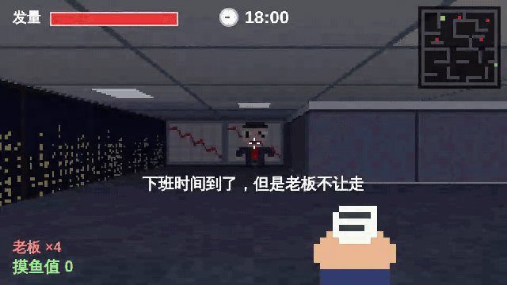

<div align="center">

# 草语言 (CaoLang) 🌿

**用中文互联网黑话写代码 · 编译成 JavaScript · 跑得跟 JS 一样快**

[**▶ 在线玩《逃离996》**](https://enochzheng1.github.io/caolang/996.html) &nbsp;·&nbsp; [**✏️ 在线写草语言**](https://enochzheng1.github.io/caolang/) &nbsp;·&nbsp; [English](README.en.md)

<a href="https://enochzheng1.github.io/caolang/996.html"></a>

*《逃离996》—— 一个 100% 用草语言写的 3D 游戏，每一个像素都是草语言算出来的。手机也能玩。*

</div>

---

> **一个基于梗的中文编程语言。写代码？不，我们叫它「整活」。**

草语言是一门用中文互联网黑话作为关键字的编程语言。变量声明叫`搞个`，函数定义叫`整活`，返回值叫`栓Q`，循环叫`卷`，跳出循环叫`润`。

如果你觉得 JavaScript 的 `undefined is not a function` 不够有灵魂，试试草语言的 `这谁啊，不认识`。

```
整活 斐波那契（n）「
  如果（n <= 1）「
    栓Q n
  」
  栓Q 斐波那契（n - 1） + 斐波那契（n - 2）
」

搞个 i = 0
卷（i < 10）「
  喊话（斐波那契（i））
  i = i + 1
」
```

别看它是梗，它是真能干活的语言：编译成 JavaScript（[比 Python 快 3~20 倍](#-编译成-javascript)），能用整个 npm 生态，能写 3D 游戏。

## 🎮 用草语言写的 3D 游戏：《逃离996》

下班时间到了，但老板不让走。在办公室迷宫里躲开老板，用辞职信砸他们，找到「下班」出口润出去。撑到 21:00 还没走？996 模式开启，老板全体狂暴。

**[▶ 现在就玩](https://enochzheng1.github.io/caolang/996.html)**（电脑用键盘，手机用屏幕上的摇杆）

- **真 3D**：光线投射（raycasting）渲染，带纹理的墙、地毯、天花板、距离雾、像素画老板，60 帧
- **每一个像素都是草语言算出来的**：没有游戏引擎，[`examples/逃离996.cao`](examples/逃离996.cao) 就是全部代码
- **老板会寻路**：BFS 距离场，穿过迷宫追你。被追上会掉发量，还要听「这个需求很简单」
- 落地窗外是还亮着灯的写字楼（大家都在加班），白板上的 KPI 永远在波动
- 结束后一键生成战绩图，看看你是「润学大师」还是「职场萌新」：


想改难度？[在 Playground 里打开](https://enochzheng1.github.io/caolang/)，第一行就是 `搞个 老板速度 = 1.6`，改完点「整活！」。

```bash
cao build examples/逃离996.cao --网页    # 编译成一个 70KB 的 HTML，双击就能玩
```

---

## 安装 Installation

```bash
# 用 npm 安装
npm install -g caolang

# 或者直接 npx 一把梭
npx caolang run hello.cao
```

### 从源码运行 Run from Source

```bash
git clone <repo-url>
cd caolang
npm install
npm run dev -- run examples/hello.cao
```

---

## 用法 Usage

```bash
cao run <文件.cao>        # 运行一个 .cao 文件（先编译成 JavaScript 再跑，快）
cao build <文件.cao>      # 编译成独立的 .mjs 文件，node 和浏览器都能跑
cao build a.cao -o b.mjs  # 指定输出文件
cao build a.cao --网页    # 编译成一个 HTML 网页（带画布，做游戏用）
cao run <文件.cao> --解释 # 用解释器跑（调试用，慢）
cao                       # 启动交互式控制台（REPL）
cao repl                  # 同上
cao tokenize <文件.cao>   # 查看词法分析结果（给卷王看的）
cao parse <文件.cao>      # 查看语法树（给更卷的卷王看的）
cao --help                # 显示帮助
cao --version             # 显示版本
```

REPL 长这样：

```
草语言 (CaoLang) v0.2.0 — 交互式控制台
输入代码开始整活，输入 .exit 退出

草> 喊话（"你好世界"）
你好世界
草> 1 + 1
2
草> 搞个 x = 42
草> x * 2
84
```

---

## 语言教程 Language Guide

### 变量：搞个

```
搞个 名字 = "张三"
搞个 年龄 = 25
搞个 是学生 = 确实
搞个 钱包 = 虚无        // 没钱，虚无
```

### 函数：整活

```
整活 加法（a，b）「
  栓Q a + b
」

喊话（加法（3，4））  // 输出: 7
```

`栓Q` 就是 return。为什么叫栓Q？因为感谢这个函数给了我一个返回值，栓Q🙏

### 条件：如果 / 啊这

```
如果（年龄 >= 18）「
  喊话（"成年了，可以整活了"）
」啊这「
  喊话（"啊这，还没成年"）
」
```

支持 else if 链：

```
如果（分数 >= 90）「
  喊话（"优秀"）
」啊这 如果（分数 >= 60）「
  喊话（"及格"）
」啊这「
  喊话（"寄"）
」
```

### 循环：卷

```
搞个 i = 0
卷（i < 10）「
  喊话（i）
  i = i + 1
」
```

卷不动了？用 `润` 跳出循环。想跳过这次继续卷？用 `继续卷`。

```
搞个 i = 0
卷（确实）「
  如果（i == 5）「润」   // 润了，不卷了
  如果（i == 3）「
    i = i + 1
    继续卷                // 跳过这次，继续卷
  」
  喊话（i）
  i = i + 1
」
```

### 布尔值：确实 / 没有内味

```
搞个 真的 = 确实           // true
搞个 假的 = 没有内味        // false（对，就是这么长，惩罚你写烂逻辑）
```

逻辑运算：

```
确实 并且 确实        // 确实
确实 或者 没有内味    // 确实
非 确实              // 没有内味
```

> **为什么 `没有内味` 这么长？** 这是 feature 不是 bug。写太多布尔判断说明你代码有问题，长一点让你反思一下。

### 错误处理：真香 / 草

```
真香「
  寄（"出大事了兄弟！"）
」草（那个错误）「
  喊话（"草！" + 那个错误）
」
```

不想处理错误？纯摆烂模式——catch 不接参数：

```
真香「
  寄（"这个错误没人管"）
」草「
  摆烂   // 错误？什么错误？我不知道
」
```

### 数组

```
搞个 水果 = ["苹果"，"香蕉"，"橘子"]
喊话（水果[0]）          // 苹果
推入（水果，"西瓜"）      // push
搞个 最后 = 弹出（水果）  // pop
喊话（长度（水果））       // 3
```

### 闭包

```
整活 制造计数器（）「
  搞个 计数 = 0
  整活 增加（）「
    计数 = 计数 + 1
    栓Q 计数
  」
  栓Q 增加
」

搞个 计数器 = 制造计数器（）
喊话（计数器（））  // 1
喊话（计数器（））  // 2
喊话（计数器（））  // 3
```

### 摆烂

有时候你就是不想写逻辑。`摆烂` 是草语言的 no-op / pass：

```
如果（今天是周一）「
  摆烂   // 周一不想干活
」
```

### 复合赋值

```
搞个 工资 = 3000
工资 += 500      // 涨薪了（假的）
工资 -= 3500     // 房租交了
```

`+=` `-=` `*=` `/=` 都有。

### 字典：「键：值」

在表达式里写 `「」` 就是字典（JSON 对象那种）：

```
搞个 打工人 = 「名字："小王"，工时：996，头发：3」

喊话（打工人.名字）        // 小王
喊话（打工人["工时"]）     // 996
打工人.工时 += 10          // 福报
打工人.老板 = "画饼大师"    // 随时加属性
喊话（打工人.存款）        // 虚无 —— 没有的键就是虚无

搞个 名字 = "小李"
搞个 新人 = 「名字」        // 简写，等于「名字：名字」
```

对着虚无读属性？`对着虚无读「名字」？你在凝视深渊`。

### 匿名整活

`整活` 不写名字，就是一个值，可以存起来、传来传去、当返回值：

```
搞个 双倍 = 整活（x）「栓Q x * 2」
喊话（双倍（21））   // 42

整活 加几（n）「
  栓Q 整活（x）「栓Q x + n」
」
喊话（加几（10）（5））   // 15
```

### 盘它：遍历

`盘它` 一个数组、字符串或者字典，挨个盘：

```
盘它（水果：["苹果"，"香蕉"]）「
  喊话（水果）
」

盘它（i，水果：["苹果"，"香蕉"]）「   // 带下标
  喊话（i，水果）
」

盘它（键，值：「a：1，b：2」）「       // 字典：键和值
  喊话（键，值）
」

盘它（i：范围（10））「               // 数数：0 到 9
  如果（i == 5）「润」                 // 润 和 继续卷 照样能用
  喊话（i）
」
```

盘个数字？`盘不动：数字不能盘，只能盘数组、字符串和字典`。

### 方法调用：x.函数（）

`x.函数（参数）` 等于 `函数（x，参数）`，所以可以一路点下去：

```
搞个 卷王们 = 打工人们
  .过滤（整活（人）「栓Q 人.工时 > 60」）
  .映射（整活（人）「栓Q 人.名字」）
  .拼接（"、"）
```

如果字典里刚好存了这个名字的函数，就调字典里的那个：

```
搞个 狗 = 「叫：整活（）「栓Q "汪"」」
喊话（狗.叫（））   // 汪
```

### 模块：拿来吧你 / 上交

想让别的文件用，先 `上交`（建议上交国家）：

```
// 梗库.cao
上交 整活 夸（名字）「
  栓Q 名字 + "，yyds！"
」
上交 搞个 名言 = ["栓Q"，"啊这"，"真香"]
搞个 私房钱 = 10000   // 没上交，别人拿不到
```

然后在另一个文件里 `拿来吧你`：

```
// main.cao
搞个 梗 = 拿来吧你（"./梗库"）   // .cao 可以省略
喊话（梗.夸（"草语言"））         // 草语言，yyds！
喊话（梗.私房钱）                 // 虚无
```

- 每个文件只会跑一次，拿多少次都是同一份
- A 拿 B、B 又拿 A？`套娃了兄弟：a.cao → b.cao → a.cao`
- 文件不存在？`拿来吧你……拿了个寂寞：找不到文件「./梗库」`

---

## ⚡ 编译成 JavaScript

草语言不是玩具解释器：`cao run` 会先把代码编译成 JavaScript，再交给 V8 跑，**速度跟手写 JS 一个级别**。

| 测试 | 草语言（编译） | 手写 JS | Python 3.13 | 草语言（旧解释器） |
|------|------|------|------|------|
| 斐波那契(30) 递归 | **39ms** | 42ms | 123ms | 3300ms |
| 1000万次循环 | **119ms** | 76ms | 2317ms | — |

> 在 Node 22 上测的。斐波那契比 Python 快 3 倍，循环比 Python 快 20 倍。卷就完事了。

编译出来的 JS 是能看的，中文名字原样保留：

```
整活 加法（a，b）「
  栓Q a + b
」
```

```js
let 加法 = function (a, b) {
  if (arguments.length !== 2) $.arity("加法", 2, arguments.length);
  return $.add(a, b);
};
```

`cao build` 会把运行时一起打包成一个独立的 `.mjs` 文件（约 27KB），`node 文件.mjs` 直接跑，不用装草语言；不引用 npm 包的话，浏览器里 `<script type="module">` 也能跑。

报错照样是梗味的，照样告诉你是哪个文件哪一行。

## 📦 用 npm 包

编译模式下，整个 npm 生态都能直接拿来用：

```
搞个 _ = 拿来吧你（"npm:lodash"）       // npm 包（先 npm install lodash）
搞个 路径 = 拿来吧你（"node:path"）     // Node 内置模块

喊话（_.chunk（范围（7），3））            // [[0，1，2]，[3，4，5]，[6]]
喊话（路径.join（"a"，"b"，"c.cao"））     // a/b/c.cao
```

草语言的数组就是 JS 数组，字典就是 JS 对象，数字字符串都一样，传进传出不用转换。JS 那边抛的错误也能用 `真香/草` 接住。

## 🖼️ 画布：做游戏

编译成网页（`cao build --网页`）或者在 Playground 里跑的时候，可以用画布画画、读键盘、放音效：

```
开画（320，180，3）          // 320×180 的画布，放大 3 倍显示

一直卷（整活（秒）「          // 每一帧调用一次，秒 = 距上一帧过了多少秒
  清屏（"黑"）
  画方块（10，10，50，30，"红"）
  写字（"你好"，20，60，"白"，16）
  如果（按住了吗（"空格"））「嘀（880，100）」
」）
```

| 函数 | 用途 |
|------|------|
| `开画（宽，高，放大?）` | 开一块画布。坐标都按「宽×高」算，显示时放大 |
| `一直卷（整活（秒）「…」）` / `别卷了（）` | 游戏主循环：每帧调用一次 / 停下 |
| `清屏（颜色?）` `画方块` `画框` `画圆` `画线` | 画图形 |
| `写字（文字，x，y，颜色?，字号?，对齐?）` | 写字，对齐是 `"左"` `"中"` `"右"` |
| `透明度（0~1）` | 接下来画的东西有多透明 |
| `像素（x，y，颜色）` / `刷像素（偏移x?，偏移y?）` | 低分辨率像素缓冲区，做复古 3D 和像素画；偏移用来做屏幕震动 |
| `颜色（r，g，b）` / `混色（a，b，比例）` | 算颜色，混色用来做雾和光照 |
| `按住了吗（键）` / `刚按了吗（键）` | 键盘。键名：`"上"` `"下"` `"左"` `"右"` `"空格"` `"回车"` 或者字母 |
| `鼠标（）` / `锁鼠标（）` / `鼠标移动（）` | 鼠标位置；锁鼠标后点一下画面就能用鼠标转视角 |
| `嘀（频率，毫秒，音量?，波形?）` / `沙沙（毫秒，音量?）` | 8-bit 音效：嘀一声 / 一阵噪音 |

颜色可以是 `颜色（r，g，b）` 算出来的数字，也可以是 `"红"` `"绿"` `"蓝"` `"黄"` `"黑"` `"白"` `"灰"` `"紫"` `"橙"` `"粉"` `"青"` `"棕"` `"金"`，或者任何 CSS 颜色比如 `"#ff0080"`。

游戏循环里出错，照样告诉你是第几行，游戏会停下来。

---

## 标点符号 Punctuation

草语言支持中文标点和 ASCII 标点，**可以混用**：

| 中文 | ASCII | 用途 |
|------|-------|------|
| `「」` 或 `『』` | `{}` | 代码块 |
| `（）` | `()` | 分组 / 函数调用 |
| `，` | `,` | 分隔符 |
| `；` | `;` | 语句终止符（可选） |
| `：` | `:` | 字典的键值 / 盘它 |

分号完全可选。草语言不需要分号，因为生活已经够累了。

---

## 内置函数 Built-ins

| 函数 | 用途 | 示例 |
|------|------|------|
| `喊话（...）` | 打印输出 | `喊话（"你好"）` |
| `类型（值）` | 返回类型名 | `类型（42）` → `"数字"` |
| `长度（值）` | 字符串/数组长度 | `长度（"你好"）` → `2` |
| `数字化（字符串）` | 字符串转数字 | `数字化（"42"）` → `42` |
| `字符串化（值）` | 任意值转字符串 | `字符串化（42）` → `"42"` |
| `推入（数组，值）` | 数组末尾添加 | `推入（arr，1）` |
| `弹出（数组）` | 数组末尾弹出 | `弹出（arr）` |
| `切片（值，开始，结束?）` | 切片 | `切片（"你好世界"，0，2）` → `"你好"` |
| `随机（）` | 随机数 [0, 1) | `随机（）` |
| `时间戳（）` | 当前毫秒时间戳 | `时间戳（）` |

### 数组

| 函数 | 用途 | 示例 |
|------|------|------|
| `范围（n）` / `范围（开始，结束，步长?）` | 生成数字数组 | `范围（3）` → `[0，1，2]` |
| `映射（数组，函数）` | map | `映射（[1，2]，整活（x）「栓Q x*2」）` → `[2，4]` |
| `过滤（数组，函数）` | filter | `过滤（范围（5），整活（x）「栓Q x>2」）` → `[3，4]` |
| `内卷（数组，函数，初始值?）` | reduce —— 把一整个数组卷成一个值 | `内卷（[1，2，3]，整活（和，x）「栓Q 和+x」）` → `6` |
| `找找（数组，函数）` | 找第一个符合的，找不到是虚无 | |
| `排序（数组，比较函数?）` | 排序（返回新数组） | `排序（[3，1，2]）` → `[1，2，3]` |
| `反转（数组或字符串）` | 反过来 | `反转（"草语言"）` → `"言语草"` |
| `躺平（数组）` | flatten —— 嵌套数组躺平一层 | `躺平（[[1]，[2，3]]）` → `[1，2，3]` |
| `去重（数组）` | 去掉重复的 | |
| `包含（容器，值）` | 数组/字符串/字典里有没有 | `包含（"草语言"，"草"）` → `确实` |
| `查找（数组或字符串，值）` | 第一次出现的下标，没有是 -1 | |
| `随便挑（数组）` | 随机挑一个 | |
| `洗牌（数组）` | 打乱（返回新数组） | |

`映射` `过滤` `找找` 的函数如果有两个参数，第二个是下标：`整活（x，i）「…」`。

### 字符串

| 函数 | 用途 | 示例 |
|------|------|------|
| `分割（字符串，分隔符?）` | split，不给分隔符就拆成单个字 | `分割（"a,b"，","）` → `[a，b]` |
| `拼接（数组，分隔符?）` | join | `拼接（[1，2]，"-"）` → `"1-2"` |
| `替换（字符串，旧，新）` | 全部替换 | `替换（"卷卷卷"，"卷"，"润"）` → `"润润润"` |
| `去空格` / `大写` / `小写` | | |
| `开头是` / `结尾是` | | `开头是（"草语言"，"草"）` → `确实` |
| `重复（字符串，次数）` | | `重复（"哈"，3）` → `"哈哈哈"` |

### 字典

| 函数 | 用途 |
|------|------|
| `键们（字典）` | 所有键 |
| `值们（字典）` | 所有值 |
| `删掉（字典，键）` | 删掉一个键，返回旧值 |

### 数学

| 函数 | 用途 |
|------|------|
| `正弦` / `余弦` / `正切` | 三角函数（弧度） |
| `反正切（y，x?）` | 给两个参数就是 atan2 |
| `圆周率` | 3.14159…（不用加括号） |
| `取整` / `四舍五入` / `绝对值` / `开方` | |
| `次方（底，指数）` | |
| `最大（...）` / `最小（...）` | 可以传多个数字，也可以传一个数组 |
| `随机整数（最小，最大）` | 两头都包含，`随机整数（1，6）` 就是掷骰子 |

---

## 梗味错误信息 Meme Error Messages

草语言的报错不说人话（但说的都是实话）：

| 场景 | 报错 |
|------|------|
| 语法错误 | `啊？这写的什么玩意儿` |
| 变量未定义 | `这谁啊，不认识: xxx` |
| 类型错误 | `类型不对啊兄弟，别乱搞` |
| 除以零 | `除以零？脑子瓦特了？` |
| 栈溢出 | `卷太狠了，栈都溢出了` |
| 参数数量错误 | `参数数量不对，搞什么飞机` |
| 数组越界 | `越界了兄弟，别越线` |
| 字符串没闭合 | `字符串没写完就跑了，引号呢？` |
| 读虚无的属性 | `对着虚无读「名字」？你在凝视深渊` |
| 在循环外面润 | `不在卷里润什么润？` |
| 循环引用 | `套娃了兄弟：a.cao → b.cao → a.cao` |
| 文件找不到 | `拿来吧你……拿了个寂寞` |
| 盘不动的东西 | `盘不动：数字不能盘` |

报错会告诉你哪一行哪一列，拼错名字还会帮你猜：

```
错误！这谁啊，不认识: 打公人们 —— 你是不是想说「打工人们」？
  --> 打工人.cao:3:4
  |
3 | 喊话（打公人们）
  |       ^ 这里有问题
```

> **单字关键字** `卷 润 寄 草 非` 不会吃掉普通词：`草莓`、`非常`、`卷子` 都是正常的变量名。

---

## 🥚 彩蛋 Easter Eggs

### 社会信用系统 Social Credit System

```bash
cao run your-file.cao --social-credit
```

如果一个函数里 `栓Q`（return）超过 5 次，编译器会警告你「太客气了」：

```
⚠️ 社会信用警告：函数「太客气了」里栓Q了8次，你也太客气了吧！
```

### 996 模式

```bash
cao run your-file.cao --996
```

如果你在晚上 9 点到早上 6 点之间跑代码，`卷`（while）循环每次迭代有 **1% 概率猝死**：

```
💀 猝死！你卷到猝死了！回去睡觉！
（996模式：深夜写代码有1%概率猝死）
```

### 严厉模式 Strict Mode

在文件开头写 `严厉`，或者用 `--strict` 标志：

```
严厉

喊话("你好")   // 用了ASCII括号，会被教育
```

```
🔴 文化自信！请使用中文标点！
第3行：发现 '('，请使用（）！
第3行：发现 ')'，请使用（）！
```

### 全部彩蛋

```bash
cao run your-file.cao --全部彩蛋
```

---

## 关键字速查表 Keyword Cheat Sheet

```
搞个    → let / var          （搞一个变量）
整活    → function           （开始整活）
栓Q    → return             （栓Q，谢谢）
喊话    → print              （大声喊话）
如果    → if                 （如果的话...）
啊这    → else               （啊这...）
卷      → while              （开始卷）
润      → break              （润了）
继续卷  → continue           （继续卷！）
摆烂    → pass / no-op       （摆烂了）
寄      → throw              （寄了）
真香    → try                （真香定律）
草      → catch              （草！）
确实    → true               （确实）
没有内味 → false              （没有内味了）
虚无    → null               （虚无）
并且    → and                （并且）
或者    → or                 （或者）
非      → not                （非）
盘它    → for-each           （盘它！）
上交    → export             （建议上交国家）
拿来吧你 → import             （拿来吧你！）
```

---

## 示例程序 Examples

`examples/` 目录下有这些示例：

- **hello.cao** — 你好世界
- **fibonacci.cao** — 斐波那契数列（递归）
- **fizzbuzz.cao** — 经典 FizzBuzz（草Buzz）
- **closures.cao** — 闭包和计数器
- **error-handling.cao** — 真香/草 错误处理
- **meme-showcase.cao** — 完整特性展示
- **social-credit.cao** — 社会信用系统彩蛋演示
- **打工人.cao** — 打工人绩效系统（字典、盘它、映射/过滤/内卷，v0.2 新特性全家桶）
- **modules/** — 模块示例：拿来吧你 / 上交
- **逃离996.cao** — 3D 第一人称游戏（画布 + 光线投射），`cao build examples/逃离996.cao --网页`

运行示例：

```bash
npm run dev -- run examples/meme-showcase.cao
```

---

## 技术细节 Technical Details

- **实现语言**: TypeScript
- **执行模型**: 编译成 JavaScript（默认），另有 tree-walking 解释器（`--解释`、REPL）；两个后端跑同一套测试，保证行为一致
- **解析器**: Pratt parser（自顶向下运算符优先级）
- **作用域**: 词法作用域，支持闭包
- **类型系统**: 动态类型（数字、字符串、布尔、虚无、数组、字典、函数）
- **运行时依赖**: 零（纯 TypeScript，无第三方依赖）
- **编译器**: AST → JavaScript，原生 JS 值（数组就是数组、字典就是对象），报错通过行号映射回 .cao 源码
- **Unicode**: 正确处理 CJK 字符，支持中文标识符
- **标点**: 中文标点在词法分析阶段归一化，解析器只看规范形式

### 空格无关的关键字识别

草语言使用**贪心前缀匹配**来识别关键字。你可以写 `搞个东西` 而不需要空格——词法分析器会自动拆分成 `搞个`（关键字） + `东西`（标识符）。因为中文本来就不用空格。

---

## 开发 Development

```bash
npm install          # 安装依赖
npm test             # 跑测试（282个，解释器和编译器各跑一遍）
npm run dev          # 用 tsx 直接跑
npm run build        # 编译到 dist/
npm run lint         # 类型检查
```

---

## License

MIT

---

<p align="center">
  <i>用爱整活 —— 草语言开发组</i>
</p>
